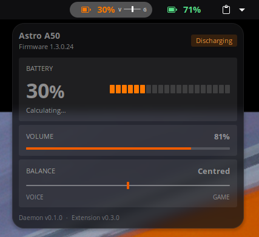

# AstroA50Battery

Battery, volume and game/voice balance for the **Astro A50 Gen 5** headset on Linux, shown in the GNOME top bar.

- **Top bar:** battery icon, percentage, and a small balance indicator.
- **Popup:** headset name, firmware, battery (with a time estimate), volume and balance.
- Read-only. It never changes any headset setting.



## How it works

| Part | What it does |
|------|--------------|
| `daemon/` | Rust service. Talks to the headset's base station over USB HID and publishes the values on the session DBus (`com.mousewatch.AstroBattery`). |
| `gnome-extension/` | GNOME Shell 45–50 extension that reads the daemon over DBus. |
| `systemd/`, `udev/` | User service and an optional udev rule. |

The headset pushes its battery, volume and balance changes by itself, so the daemon does not poll. If the base station drops off USB and comes back, the daemon reconnects on its own.

## Requirements

- Astro A50 Gen 5 base station (USB ID `046d:0b1c`). Other A50 models (Gen 4, A50 X) are not supported.
- GNOME Shell 45–50 on Linux with a systemd user session
- glibc 2.39 or newer for the pre-built binary (Ubuntu 24.04 / Fedora 40 or newer). On older systems, build from source.
- Rust toolchain (`cargo`) only if you build the daemon from source

## Install

```bash
git clone https://github.com/DenizSAHIN570/AstroA50Battery.git
cd AstroA50Battery
./install.sh
```

This downloads the pre-built daemon from the latest GitHub release (or builds it from source if there is no release yet), installs it to `~/.local/bin`, enables a systemd user service and copies the extension. No `sudo` needed. Building from source needs `cargo`; the release binary does not.

Then log out and back in (Wayland needs this to load a new extension) and run:

```bash
gnome-extensions enable astro-a50-battery@gnome
```

If the daemon logs a permission error opening the headset (`journalctl --user -u astro-battery`), install the udev rule so your session can access the device. `install.sh` prints the command. Some distros already grant this access; many don't.

## Update

```bash
git pull
./install.sh
```

## Time estimates

The headset only reports battery in steps of 5%, so the estimate is learned from how long each step takes. It shows "Calculating…" until it has timed one full step (about an hour of use), then remembers the rate in `~/.local/share/astro-battery/`. "Time left" counts hours of use: it pauses while the headset is off or docked.

## Status

Tested on one headset (firmware 1.3.0.24) on Nobara Linux with GNOME 50. Behaviour when the headset goes out of range is untested.

## Notes

The protocol was worked out from USB captures of Logitech G HUB; details are in [`FINDINGS.md`](FINDINGS.md). This is an unofficial project and is not affiliated with Logitech or Astro.
